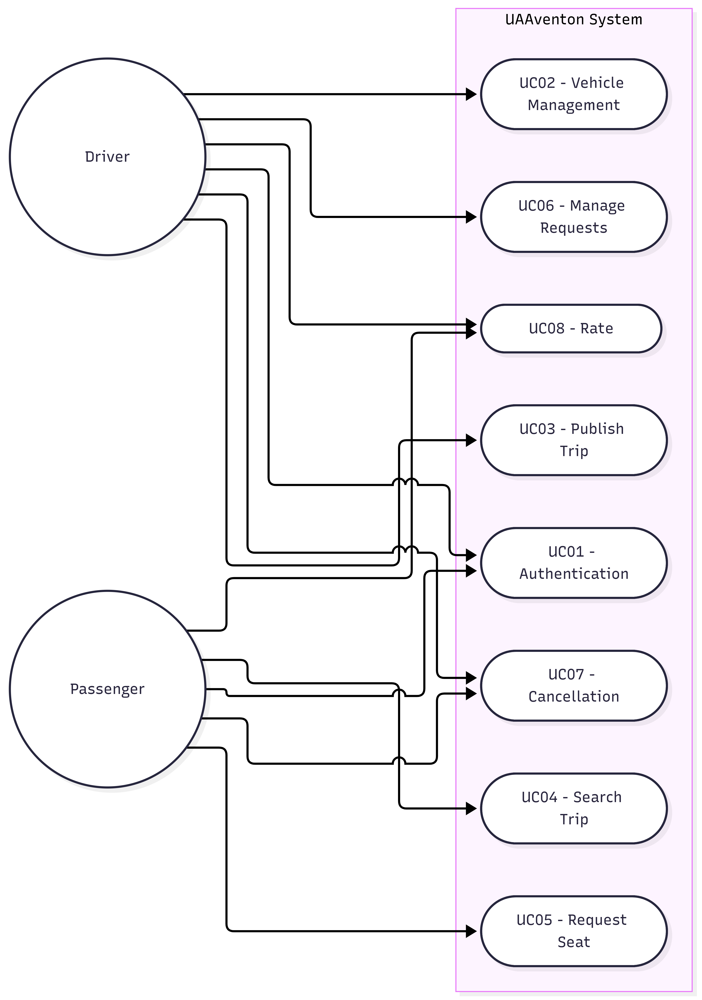

# Use Cases - UAAventon

**System Actors:**
1. **Passenger:** Student searching for a ride to their destination.
2. **Driver:** Student offering available seats in their vehicle.

**Use Case List:**
- **UC01 - Authentication:** Log in using a `@edu.uaa.mx` email address.
- **UC02 - Enable Driver Profile:** A user provides their driver's license and accepts terms and conditions to enable vehicle registration (`is_driver = true`).
- **UC03 - Vehicle Management (Driver):** Register, update, or remove a car.
- **UC04 - Publish & Manage Trip (Driver):** Create a route specifying origin, destination (using Google Places API), available seats, and fare. Manually update the trip status to "In Progress" or "Completed".
- **UC05 - Search Trip (Passenger):** Filter available trips by destination or date.
- **UC06 - Request Seat (Passenger):** Join a published trip.
- **UC07 - Manage Requests (Driver):** Accept or decline passenger join requests for a trip.
- **UC08 - Cancellation & Penalties:** Cancel a trip (Driver) or leave a booked seat (Passenger). An automatic rating reduction applies if the cancellation occurs less than 2 hours before the scheduled departure.
- **UC09 - Rate:** Assign a 1 to 5-star rating upon trip completion.

